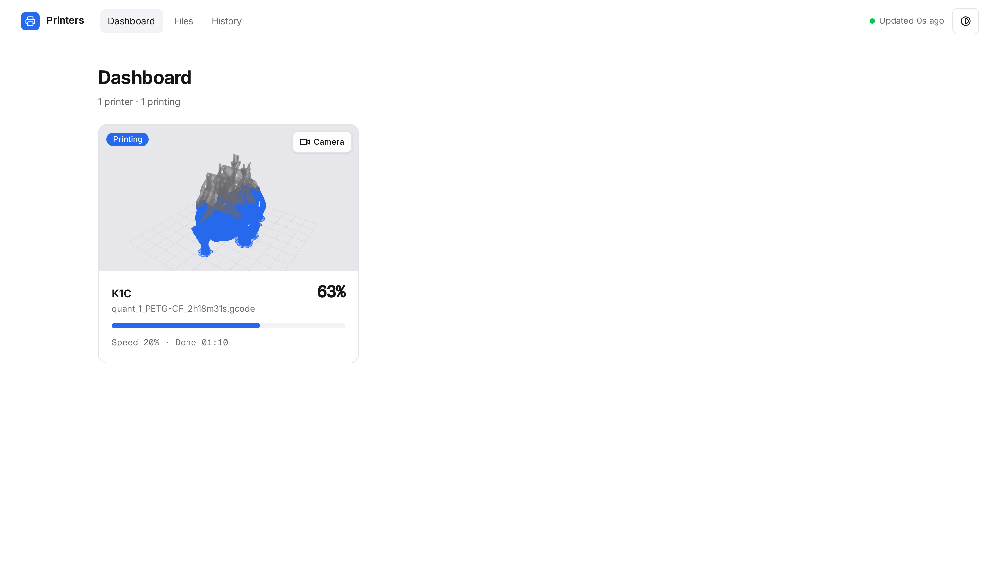
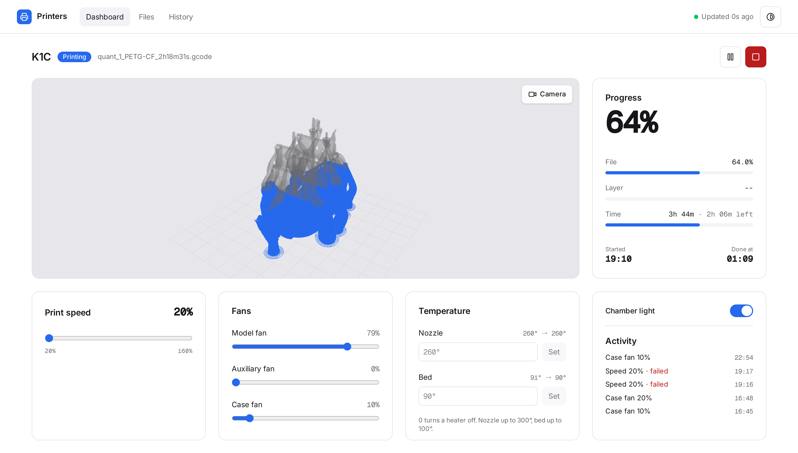
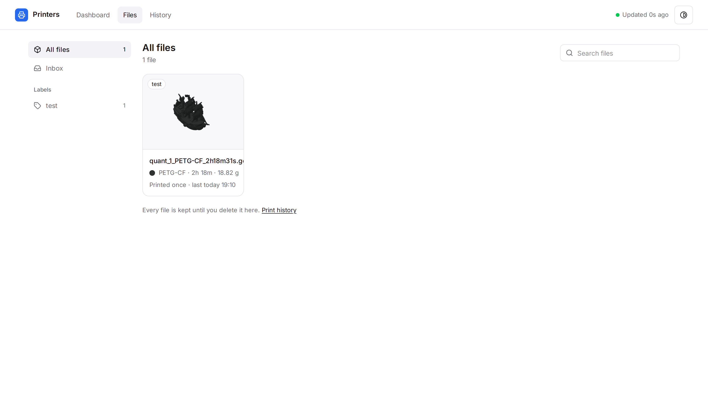
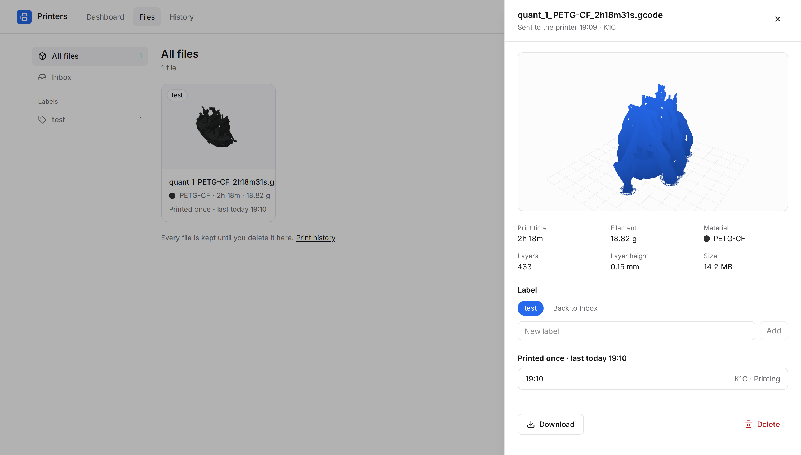
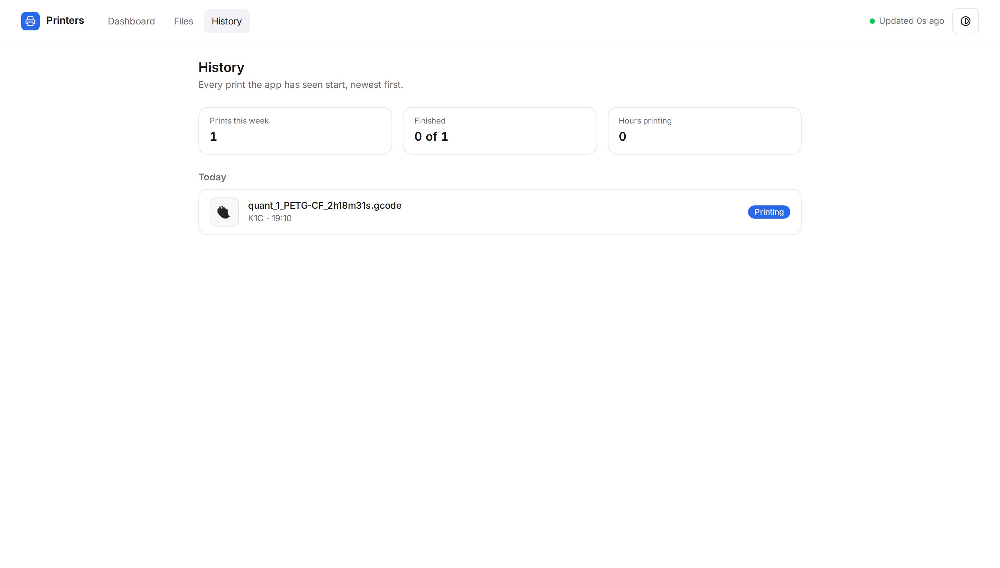
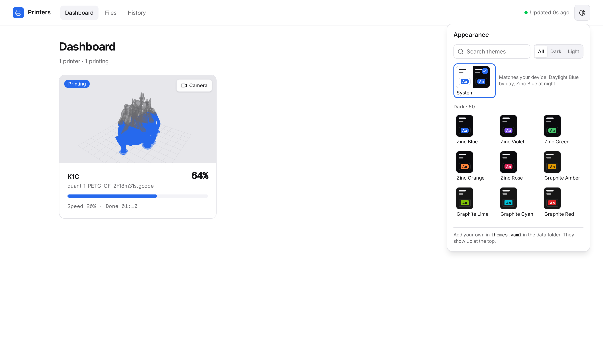
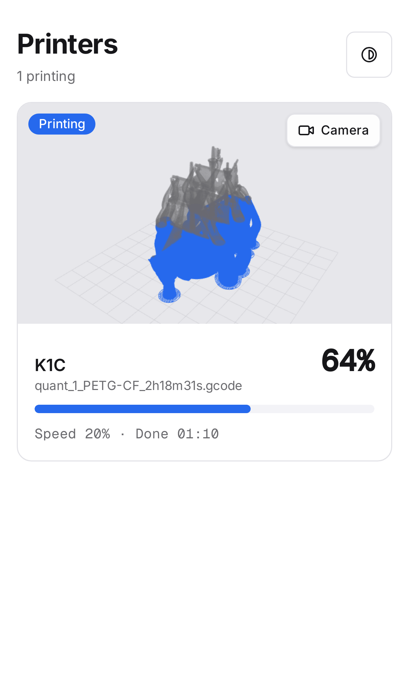
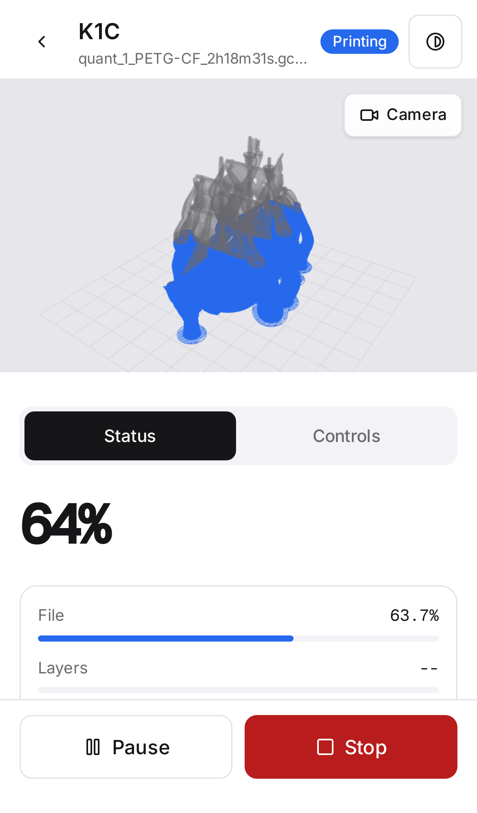

# Printer app

A self-hosted web app for watching and controlling 3D printers on your home
network. It gives you a dashboard of every printer and a page per printer, on
desktop and phone, with a 3D view of the print in progress, the printer's live
camera and its controls. It also keeps a copy of every file you send to the
printer from your slicer, lets you sort them with labels, and records every
print.

It runs as one Docker Compose stack on any always-on machine that can reach
your printers (a home server or a NAS), and is meant to
be reached over a private network: your LAN, Tailscale or WireGuard. It is
built and tested against a Creality K1C on stock firmware, and works with
printers that run Klipper with Moonraker.

You keep slicing and sending from your slicer as usual (Creality Print,
OrcaSlicer, ...), and the app watches. With controls turned on, you can also
print any file the app has kept again, straight from its Files page, even after
it's gone from the printer.

## Screenshots

The dashboard, with the 3D model of the print in progress:



The printer page: progress, the 3D model (or the live camera), speed, fans,
temperatures, the light and the latest actions:



Files captured from the printer, with a file's details, and the print history:







The theme picker, with 100 built-in themes:



On a phone:

<p>
  
  
</p>

## Features

- **Live status** pushed from the printer over one websocket: state, progress,
  layer, time left, temperatures and fans. No polling.
- **3D preview** of the toolpath being printed, with the printed part
  highlighted and a dot at the nozzle.
- **Live camera** for Creality printers on stock firmware (WebRTC), relayed by
  the server so every open page shares one stream from the printer.
- **Controls** (off by default): pause, resume, stop, print speed, fans,
  nozzle and bed targets, and the chamber light, each a fixed command, with an
  action log.
- **Print from Files** (needs controls): send the app's copy of a kept file to
  the printer and start it, after a confirmation.
- **File capture**: a copy of every `.gcode`/`.3mf` sent to the printer, with
  the slicer's thumbnail, time, material and filament, sorted with labels.
- **History** of every print, how it ended, and the file it came from.
- **Time-lapses**: a camera frame per layer of every print, saved on your
  storage and played back from the print's History entry.
- **Themes**: 100 base themes, plus your own in a YAML file.
- **Careful with the printer**: one connection per printer, no port scanning,
  one reconnect every 30 seconds when it's offline, and read-only unless you
  turn controls on.

## What you need

- A machine that stays on, can reach the printer on your network, and runs
  Docker with the Compose plugin. Linux is what it's built for.
- A printer that runs **Moonraker** (Klipper). That includes Creality's K1,
  K1C and K2 family, where Moonraker answers on port 7125. `printers.yaml`
  already accepts OctoPrint, PrusaLink and Bambu entries, but only the
  Moonraker driver exists so far.
- Optional: Tailscale (or WireGuard) if you want to open the app away from
  home.

## Set it up on your network

### 1. Give the printer a fixed address

The app connects to the printer by IP address, so reserve one for it in your
router's DHCP settings (look for "DHCP reservation" or "static lease"). The
printer's current address is in its screen's network settings, or in your
router's list of devices.

You can check Moonraker answers from the machine that will run the app with a
single request (swap in your printer's address):

```
curl http://<printer-ip>:7125/server/info
```

### 2. Get the code

```
git clone https://github.com/safchow/printer-app.git
cd printer-app
```

### 3. Settings: `.env`

```
cp .env.example .env
```

Open `.env` and set:

- `BIND_ADDRESS`: the address the app listens on. Use the machine's **LAN IP**
  (for example `192.168.1.20`) to reach it from anything at home, its
  **Tailscale IP** (`100.x.y.z`, from `tailscale ip -4`) to reach it only over
  Tailscale, or leave `127.0.0.1` to reach it only from the machine itself.
  Don't use `0.0.0.0`, and don't forward the port on your router: the app has
  no login and is meant for a private network only.
- `ALLOWED_HOSTS`: only if you open the app by a **name** rather than its IP
  address (a Tailscale MagicDNS name, a hosts-file entry...). List the names,
  comma separated, without the port. See
  [Other web pages can't use the app](#other-web-pages-cant-use-the-app).
- `PORT`: the web port, 8090 by default.
- `TZ`: your time zone, for example `Europe/London`, so times in the app are
  local.
- `PUID` / `PGID`: the user and group the container runs as, 1000:1000 by
  default. If your user isn't 1000, add `PUID=` and `PGID=` with the values of
  `id -u` and `id -g`.

Every other setting has a safe default; the full list is under
[Settings](#settings-env).

### 4. Your printers: `printers.yaml`

```
cp printers.example.yaml printers.yaml
```

Set `host` to the address from step 1 and give the printer an `id` (used in
URLs) and a `name`. For a K1C on stock firmware the rest of the example is
already right: `type: moonraker`, `port: 7125`, `camera: creality_webrtc`, and
`cfs: true` if you have the Creality Filament System. List more printers under
`printers:` the same way.

The fan and light names under `moonraker:` are the K1C's. For other printers,
see [Finding your printer's object names](#finding-your-printers-object-names).

### 5. Folder ownership

The app writes its database to `./data` and captured print files to
`./library`. Both come with the repository, so they belong to the user who
cloned it. Make sure that user matches `PUID:PGID`:

```
ls -ld data library          # should show your user
sudo chown -R "$(id -u):$(id -g)" data library   # only if they don't
```

If you point `DATA_DIR` or `LIBRARY_ROOT` somewhere else, create those folders
first and give them to the same user. If Docker creates a missing folder
itself, it belongs to root: the app can't write there, and it starts with file
capture turned off.

### 6. Check, then start

Check the config without touching any printer:

```
docker compose run --rm printer-api python -m app.doctor
```

Then build and start the stack (the app and the camera relay):

```
docker compose up -d --build
```

Open `http://<BIND_ADDRESS>:<PORT>`, for example `http://192.168.1.20:8090`.
On a phone you can add it to the home screen.

### 7. Optional: turn things on or off

All in `.env`, followed by `docker compose up -d`:

- `CONTROLS_ENABLED=true` turns on the printer controls. They're **off by
  default**: until then the app only listens to the printer, and every control
  answers "turned off". See [Controls](#controls) for exactly what each button
  sends.
- `CAPTURE_FILES=false` stops keeping copies of files sent to the printer.
- `GCODE_PREVIEW=false` stops the once-per-print download for the 3D preview.
- `GO2RTC_URL=` (empty) turns the camera relay off; see
  [Direct mode](#direct-mode-relay-off).

Your own colour themes go in `./data/themes.yaml`; see [Themes](#themes) and
`themes.example.yaml`. They show up on the next page load, with no restart.

### Use it away from home with Tailscale

1. Install Tailscale on the machine running the app and on your phone or
   laptop, signed in to the same tailnet.
2. Set `BIND_ADDRESS` in `.env` to the machine's Tailscale IP
   (`tailscale ip -4`) and run `docker compose up -d`.
3. Open `http://<tailscale-ip>:8090` from any of your devices. To use the
   machine's MagicDNS name instead, add it to `ALLOWED_HOSTS` in `.env`
   (for example `ALLOWED_HOSTS=myserver,myserver.tail1234.ts.net`).

The printer itself doesn't need to be on Tailscale: the app talks to it over
your LAN, and with the camera relay (the default) the video comes through the
app too.

Docker can only listen on a Tailscale IP once Tailscale is up. If the stack
starts before Tailscale after a reboot, run `docker compose up -d` again.

### Updating

```
git pull
docker compose up -d --build
```

Database changes are migrated automatically at startup.

### Finding your printer's object names

Fan and light names differ between printers. The defaults in
`printers.example.yaml` are a stock-firmware K1C's. To see your printer's,
run this **once, while the printer is idle**:

```
docker compose run --rm printer-api python -m app.doctor --probe
```

It makes three read-only GET requests per printer (`/server/info`,
`/printer/info`, `/printer/objects/list`), one at a time with a pause between
them and no retries, and prints the fans, pins, lights and heaters it finds.
Put the ones you want under `moonraker:` in `printers.yaml`.

### A note on Creality printers

Creality's printers are less robust on the network than a PC. Don't port-scan
them or point monitoring tools at them while they print: a K1C can restart
mid-print under that kind of load. This app was written with that in mind. It
holds one websocket per printer, only talks to the host and port in
`printers.yaml`, makes at most one camera handshake per printer every 5
seconds, downloads a file only once (when it arrives, or when its print
starts), and only uploads a file when you press Print.

## How it works

The rest of this file goes into detail on each part.

## How it talks to printers

printer-api keeps **one websocket per printer** (Moonraker's
`ws://<host>:7125/websocket`), subscribes to the status objects once, and the
printer pushes changes from then on, so there's no polling. Browsers get those
changes over one WebSocket from printer-api.

These rules are enforced in the driver, not just the UI:

- one connection per printer, only to the host and port in `printers.yaml`; no scanning;
- when a printer drops or can't be reached, it shows as offline with its
  last-seen time, and the app tries **one** reconnect every 30 seconds;
- read-only unless `CONTROLS_ENABLED=true`: until then the only method the
  driver sends is `printer.objects.subscribe`, and the control endpoints return
  `501`. With controls on, only the fixed commands under [Controls](#controls)
  can be sent.

## Live camera

Creality printers on stock firmware stream their camera over WebRTC. By
default the app runs a small relay, [go2rtc](https://github.com/AlexxIT/go2rtc),
next to printer-api. The server holds one connection to the printer's camera
while anyone is watching, and passes the video on to every open page. Both
pages show the 3D model of the print first; the **Camera** button switches
to the live camera, which connects only while it is shown and stops when you
switch back or hide the tab. Browsers only talk to the app, so they need no route to the
printer. How it works, the K1C quirks it fixes and its limits are in
[docs/camera-relay.md](docs/camera-relay.md).

printer-api allows at most one camera handshake per printer every 5 seconds
(`CAMERA_MIN_INTERVAL`).

### Direct mode (relay off)

Set `GO2RTC_URL=` (empty) in `.env` to turn the relay off. On the printer page,
**Watch live** then sends the browser's WebRTC offer to printer-api, which
passes it to the printer's `http://<host>:<camera_port>/call/webrtc_local`
(port 8000 by default) and returns the answer. The video flows from the printer
straight to your browser, so your device must be able to reach the printer's
address:

- **Tailscale:** on the machine running the app, advertise a route for just the
  printer's address and approve it in the admin console:
  ```
  echo 'net.ipv4.ip_forward = 1' | sudo tee /etc/sysctl.d/99-tailscale.conf
  sudo sysctl -p /etc/sysctl.d/99-tailscale.conf
  sudo tailscale set --advertise-routes=<printer-ip>/32
  ```
  Phones, Macs and Windows accept routes by default; Linux clients need
  `sudo tailscale set --accept-routes`.
- **WireGuard:** add the printer's IP to the client's `AllowedIPs`.
- **LAN:** nothing to do.

## Controls

With `CONTROLS_ENABLED=true` in `.env`, the printer page's buttons work:
Pause, Resume and Stop (Pause and Stop ask first), a print speed slider (20 to
160%), fan sliders, nozzle and bed targets, and the chamber light. Each button
sends exactly one fixed command. On Moonraker printers:

| Control | Command | Allowed |
| --- | --- | --- |
| Pause / Resume / Stop | `printer.print.pause` / `resume` / `cancel`, or the `PAUSE` / `RESUME` / `CANCEL_PRINT` macros if the printer's Moonraker lacks those methods | while printing or paused |
| Speed | `M220 S20` to `S160`, steps of 10 | while printing or paused |
| Fans | `SET_FAN_SPEED FAN=<name> SPEED=0..1`, steps of 10% | while online |
| Nozzle / bed | `M104 S<°C>` / `M140 S<°C>`: 0, or 30 to 300 (nozzle) / 100 (bed) | while online |
| Light | `SET_PIN PIN=<pin> VALUE=0/1` | while online |
| Print (Files page) | one upload of the app's copy, then `printer.print.start` (or the `SDCARD_PRINT_FILE` macro) | while idle, complete or cancelled |

The rules are enforced on the server, not just in the page. The driver only
sends G-code that matches its allowlist exactly, and the API never accepts
G-code text. It allows one command per printer at a time, at most one a
second, and never retries one. Nothing is sent while the printer is offline.
Every press, including refused ones, goes into the action log. The printer
page shows the last 20 presses, and `GET /api/printers/{id}/actions` returns
the full history.

## 3D preview of the print

The printer page and each dashboard card draw the toolpath of the file being
printed in 3D, with the printed part in the accent colour and a dot where the
nozzle is. Drag to turn it, scroll to zoom.

To do that, printer-api downloads the G-code being printed from the printer's
Moonraker (`GET /server/files/gcodes/<file>`) **once per print**, when it first
sees the print. It never retries, even if the download fails, keeps the file in
`DATA_DIR/gcode/<printer>/` (so a restart doesn't fetch it again), and caps it
at 200 MB. Browsers get it from printer-api, never from the printer. Set
`GCODE_PREVIEW=false` to turn this off.

## Files and history (file capture)

When you send a file to the printer, Moonraker tells printer-api over the
websocket it already has open (`notify_filelist_changed`). The K1C announces the
file (`create_file`) while it is still arriving, can then go quiet for 10+
seconds mid-transfer, and sends `modify_file` with the full size when it's done.
printer-api waits for that, then downloads the file from the printer **once**
(`GET /server/files/gcodes/<file>`) and keeps it only if its size matches the
notice; a partial copy is thrown away. If no `modify_file` ever comes, it tries
once two minutes after the last notice and again keeps the copy only if the size
matches what the printer announced.
Hidden folders such as `.thumbs/` are never fetched, and only `.gcode` and
`.3mf` files are kept.

- Files are stored by content (`LIBRARY_ROOT/files/<sha256>`), so sending the
  same file again, even under a new name, is one entry that keeps its label.
- New files land in the **Inbox** on the Files page. Give a file a label to
  file it away; labels are made as you type them.
- Time, material, colours, filament and layers come from the slicer's comment
  header, plus its largest thumbnail.
- Every copy is kept until you delete it in the app. Deleting a file on the
  printer doesn't touch the app's copy, and deleting in the app doesn't touch
  the printer.
- The **History** page lists every print the app has seen start, with how it
  ended, linked to its file. A file already captured is reused for the 3D
  preview, so a print of it costs no download at all.

Set `CAPTURE_FILES=false` to turn this off (the 3D preview then works as
before).

## Printing a kept file

With `CONTROLS_ENABLED=true`, a file's details on the Files page (desktop) have
a **Print** button. It asks first, showing the print time and material, then
the server:

1. checks again that the printer is online and not printing or in error;
2. uploads **the app's own copy** of the file, once, as
   `printer-app_<name>` at the top of the printer's G-code folder (spaces
   become `_`). The app always sends its copy, so a file you cleared off the
   printer can still be printed, and these uploads are never captured back as
   new files;
3. starts it with one `printer.print.start` (or `SDCARD_PRINT_FILE`).

Nothing is retried. If the printer refuses, the page shows the printer's own
reason, and the press goes into the action log either way. The print links to
the file it came from in History.

How the file is uploaded is set per printer in `printers.yaml` with `upload:`:

- `auto` (the default): `creality` for Creality printers (a CFS or a Creality
  camera), otherwise `moonraker`.
- `creality`: the printer's own upload server, `POST
  http://<host>:<upload_port>/upload/<name>` (port 80 by default), which is what
  Creality Print uses. A stock K1C's Moonraker refuses uploads with
  "upload file fail", so this is the one that works there.
- `moonraker`: Moonraker's `/server/files/upload`, for other Klipper printers.

The uploaded `printer-app_*` files stay on the printer until you delete them
there.

## Time-lapses

While a print runs, printer-api keeps one camera connection open through the
relay and saves a frame on every layer change (about 15 KB each on the K1C).
Open the print in History and press **Time-lapse** to play it over the model
view. Frames go to `TIMELAPSE_DIR`, which must hold a `.timelapse-root` file
first, so an unmounted NAS never fills the system disk. See
[docs/timelapse.md](docs/timelapse.md).

## Other web pages can't use the app

The app has no login, so it relies on being on a private network. But a web
page you have open elsewhere, on a device that can reach the app, could still
ask your browser to send it requests: to stop a print, delete a file, start a
print or open the camera. The app refuses those:

- Anything that changes something (POST, PATCH, DELETE) and every WebSocket
  must come from the app's own page. Browsers say where a request comes from
  (the `Origin` and `Sec-Fetch-Site` headers); a request from another page gets
  `403` and changes nothing.
- The app only answers when it's addressed by an IP address, `localhost`, or a
  name in `ALLOWED_HOSTS`. That stops a site from pointing its own name at the
  app's address to look like the app (DNS rebinding).

Scripts and `curl` send neither header and still work. If you put the app
behind a reverse proxy, the proxy must pass the original `Host` header on. A
refused request is logged with the reason.

## Themes

The appearance button in the top bar opens a theme picker: **System** (follows
your device's light or dark setting) and 100 base themes, 50 dark and 50 light,
with search and a Dark / Light filter. Each browser remembers its own choice.

The base themes live in `api/app/themes/base.yaml`, generated by
`api/scripts/make_base_themes.py`, which checks every text colour reads at
4.5:1 or better on the surfaces it sits on.

To add your own, create `themes.yaml` in the data folder (`./data/themes.yaml`
with Docker; or point `THEMES_FILE` at it when running without Docker). See
`themes.example.yaml`. The app picks up changes on the next page load, with no
restart.

```yaml
default:            # optional: what System uses
  dark: carbon-spool
themes:
  - id: carbon-spool          # new theme, shown under "Yours" at the top
    name: Carbon spool
    mode: dark
    extends: carbon-teal      # start from any theme, change only what differs
    radius: 6                 # corner size in px, 0-24
    font: inter               # inter, system, mono or serif
    colors:
      accent: "#14b8a6"
  - id: zinc-blue             # a base theme's id changes that theme
    colors:
      accent: "#7c3aed"
```

A theme needs `mode` and the colours `background`, `foreground` and `accent`
(directly or through `extends`); the rest (cards, borders, muted text, warning
colours...) are worked out from those unless you set them. The full list of
colours is at the top of `base.yaml`. A theme with a bad colour or text that
would be hard to read is left out and the reason is logged; it never stops
the app.

## Try it without a printer

```
PRINTERS_FILE=./printers.fake.yaml docker compose --profile fake up -d --build
```

The fake Moonraker plays a print, and a fake camera answers the handshake (no real video). Switch states or drop it offline:

```
docker compose exec fake-moonraker python -c "import urllib.request as u; u.urlopen(u.Request('http://127.0.0.1:7125/fake/scenario/paused', method='POST'))"
# scenarios: printing, paused, idle, complete, cancelled
# offline:   .../fake/offline?seconds=60
```

## Development

```
# API
cd api
python -m venv .venv && . .venv/bin/activate
pip install -r requirements-dev.txt
pytest                                      # runs against the fake Moonraker only

python ../fakes/fake_moonraker.py --port 7125 &   # a fake printer
PRINTERS_FILE=../printers.dev.yaml python -m app  # http://127.0.0.1:8090

# Web app (proxies /api to 127.0.0.1:8090)
cd web
npm install
npm run dev
```

The database schema is managed with Alembic and migrated at startup. After
changing a table in `api/app/db.py`, add a migration with
`alembic revision --autogenerate -m "..."` from `api/`.

## Settings (.env)

| Setting | What it does | Default |
| --- | --- | --- |
| `BIND_ADDRESS` | Private address the web app listens on | `127.0.0.1` |
| `PORT` | Web port | `8090` |
| `DATA_DIR` | Database | `./data` |
| `LIBRARY_ROOT` | Captured print files | `./library` |
| `PRINTERS_FILE` | Which printers file to mount | `./printers.yaml` |
| `TZ` | Time zone for times in the app | `UTC` |
| `ALLOWED_HOSTS` | Names (besides IP addresses and `localhost`) the app may be opened by | empty |
| `THEMES_FILE` | Your own themes file (see Themes) | `DATA_DIR/themes.yaml` |
| `CONTROLS_ENABLED` | Turns on the printer controls | `false` |
| `GCODE_PREVIEW` | Fetch the current print's G-code once per print for the 3D preview | `true` |
| `CAPTURE_FILES` | Keep a copy of each file sent to the printer, and the print history | `true` |
| `TIMELAPSE_DIR` | Where time-lapse frames go (needs a `.timelapse-root` file) | `./timelapse` |
| `TIMELAPSE` | Record a time-lapse of every print (needs the camera relay) | `true` |
| `TIMELAPSE_MIN_FREE_GB` | Stop saving frames below this much free space | `20` |
| `CAMERA_MIN_INTERVAL` | Seconds between camera handshakes per printer | `5` |
| `GO2RTC_URL` | Camera relay address; empty turns the relay off (direct mode) | `http://go2rtc:1984` |
| `PUID` / `PGID` | User the container runs as | `1000` |
| `IMPORT_TOKEN` | Enables the import endpoint (later version) | empty = off |
| `TAILSCALE_SOCKET` | Device names in the action log (later version) | unset |

## License

[MIT](LICENSE). The app controls real hardware: use it at your own risk, and
keep an eye on your printer.
